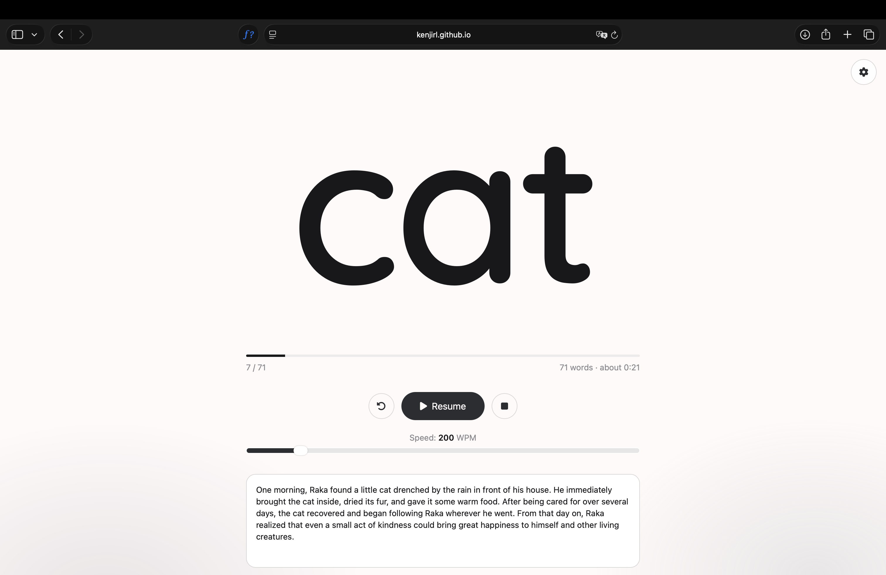
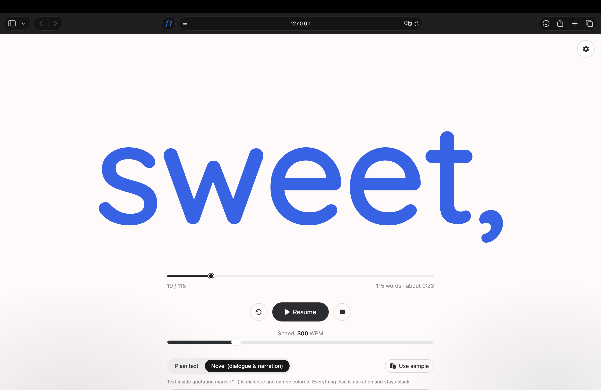
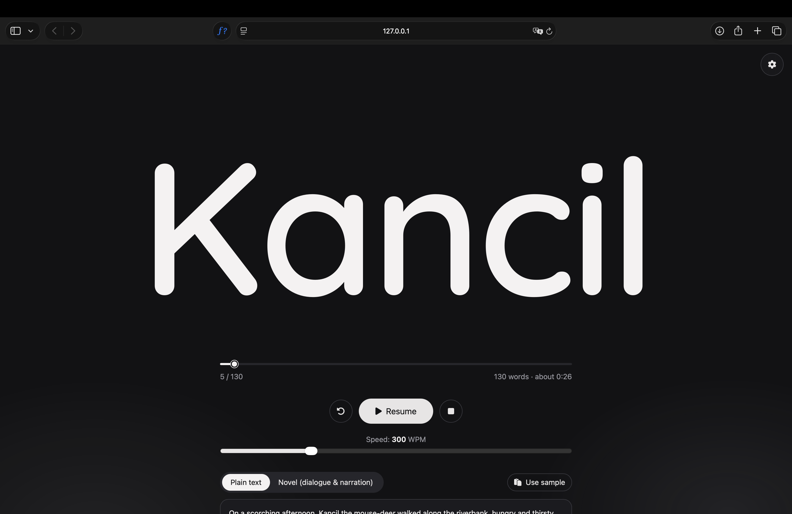
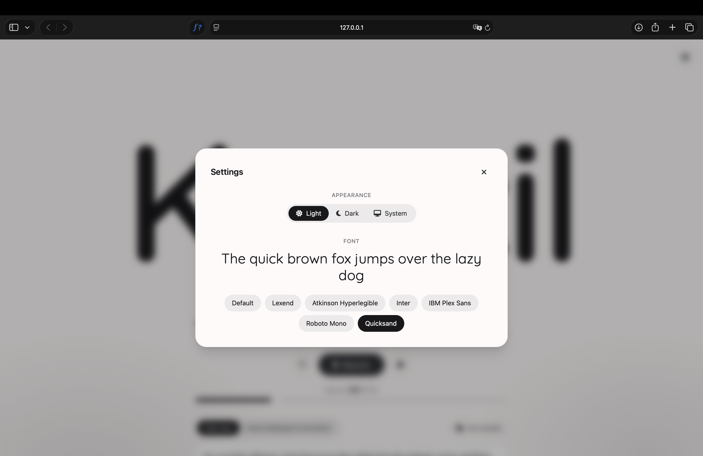
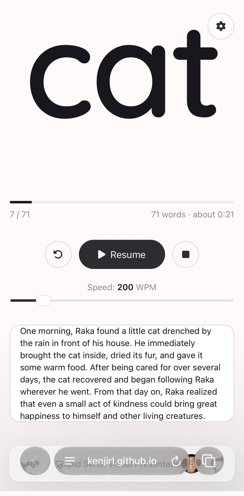

<div align="center">


# Fast Read

**Rapid Serial Visual Presentation, made calm.**
One word at a time. Big, centered, and impossible to lose your place.


</div>

<br />

<p align="center">
  
</p>

## What is this?

Fast Read is a small web app for **speed reading with RSVP** (Rapid Serial Visual Presentation). Instead of moving your eyes across a page, the words appear one by one in the same spot, so your eyes stay still and your brain does the reading.

Paste any text, pick a speed, press **Start**. Not sure what to read? Hit **Use sample** to load a short story.

## Highlights

| | Feature | Details |
|---|---|---|
| 🎯 | **Single-column stage** | The current word fills 80% of the screen width, nothing else competes for attention. |
| 📐 | **Auto-fit text** | Font size is recalculated for every word, so long words shrink instead of getting cut off. |
| ✂️ | **Long-word splitting** | Words over 14 characters are split with a hyphen (`extraordi-` → `narily`) to stay readable on small screens. |
| ⏱️ | **Natural rhythm** | Punctuation, long words and switches between narration and dialogue stay on screen a bit longer. |
| 🚀 | **100 – 900 WPM** | Adjust speed live, even while reading. |
| 🎚️ | **Seekable progress** | Drag the progress slider to jump to any word, forward or back. Word counter and estimated reading time included. |
| 📖 | **Novel mode** | Separates narration from dialogue by quotation marks. See [Novel mode](#novel-mode). |
| 🎨 | **Dialogue colors** | 10 ready-made colors plus a custom picker, chosen per dialogue. |
| 🌗 | **Light, dark or system** | Pick a theme in Settings, or follow your OS. Remembered between visits. |
| 🔤 | **7 fonts** | Default, Lexend, Atkinson Hyperlegible, Inter, IBM Plex Sans, Roboto Mono and Quicksand. Your choice is remembered. |
| 🧪 | **Sample texts** | One click loads a short Kancil story for plain text or novel mode. |
| ⌨️ | **Keyboard friendly** | Full control without touching the mouse. |

## Novel mode

Switch to **Novel (dialogue & narration)** above the text box. Text inside quotation marks is dialogue, everything else is narration.

```text
On a sunny morning in Windy Meadows.
"Nice weather today, isn't it?" I said.
Father looked up at the sky, "Yes, it looks like it will be clear all day."
```

- **Narration** keeps the regular text color.
- **Dialogue** is colored. Every dialogue is listed in a small table under the text box, where you click its color chip to pick one of 10 ready-made colors or a custom one. Give each character their own color.
- **Quote pauses:** every opening or closing quotation mark adds a short pause on top of normal punctuation, and one quote right after another (a change of speaker) pauses a little longer.
- Straight (`"`) and curly (`“ ”`) quotes both work. An unclosed quote ends at the end of its line.
- Chosen colors are kept while the page is open. In dark mode the 10 ready-made colors switch to lighter versions so they stay readable.

## Screenshots

<table>
  <tr>
    <td align="center"><b>Novel mode</b><br /></td>
    <td align="center"><b>Dark mode</b><br /></td>
  </tr>
  <tr>
    <td align="center"><b>Settings</b><br /></td>
    <td align="center"><b>Mobile</b><br /></td>
  </tr>
</table>

## Keyboard shortcuts

| Key | Action |
|---|---|
| `Space` | Start / pause / resume |
| `←` | Previous word |
| `→` | Next word |
| `Esc` | Close the settings panel or color picker |

Shortcuts are paused while you type in the text box.


## How it works

1. The text is split on whitespace and long words are broken into chunks. In novel mode it is first split into narration and dialogue by quotation marks, and each word remembers its color.
2. A chain of `setTimeout` calls shows one word at a time. Delay = `60000 / WPM`, multiplied for punctuation, long words and narration/dialogue transitions. Changing the speed slider applies from the next word.
3. After each word, the font size is fitted to the stage width.
4. The progress slider jumps to any word. Dragging it while paused shows that word and resumes from there.
5. Font and theme are saved in `localStorage`. Dark mode swaps the color tokens through CSS variables, so the same classes work in both themes.


<div align="center">
<sub>Built with focus, one word at a time.</sub>
</div>